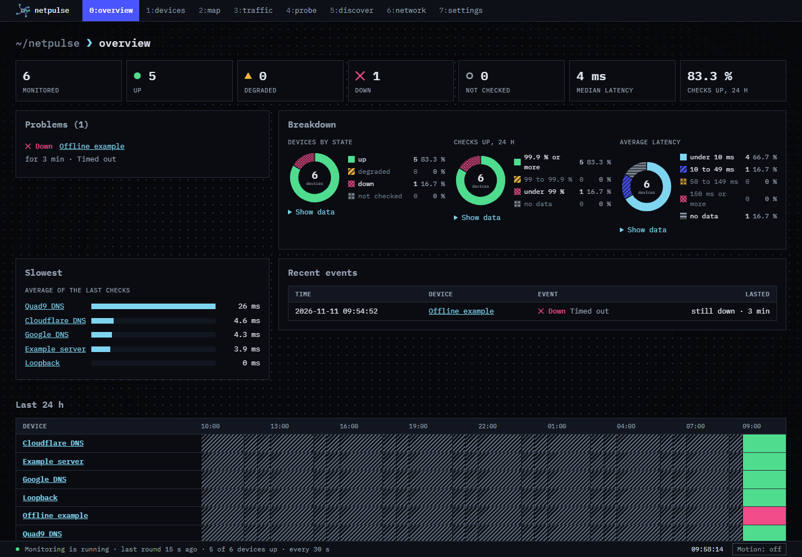
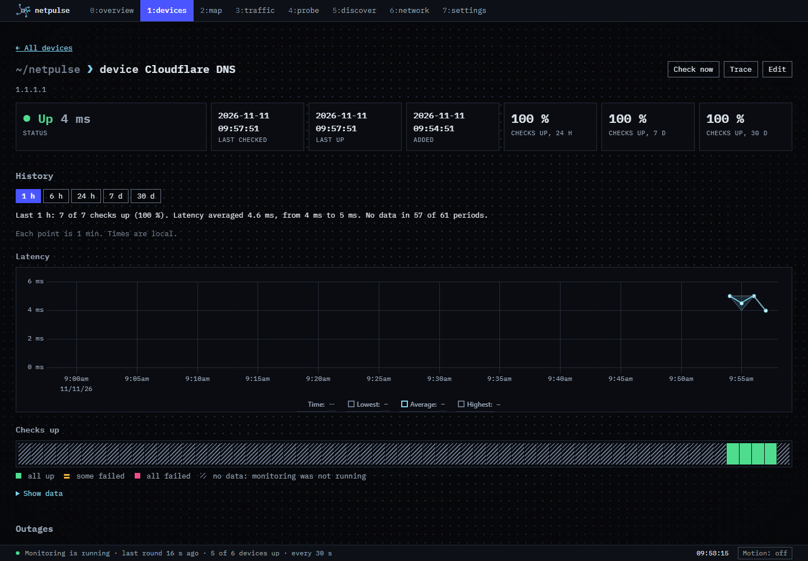
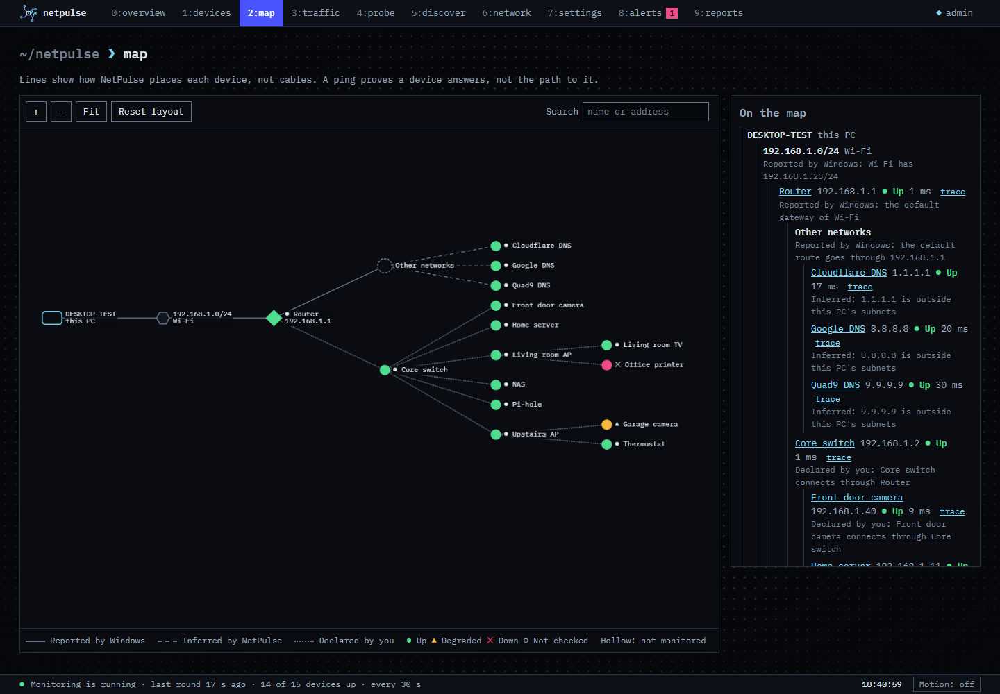
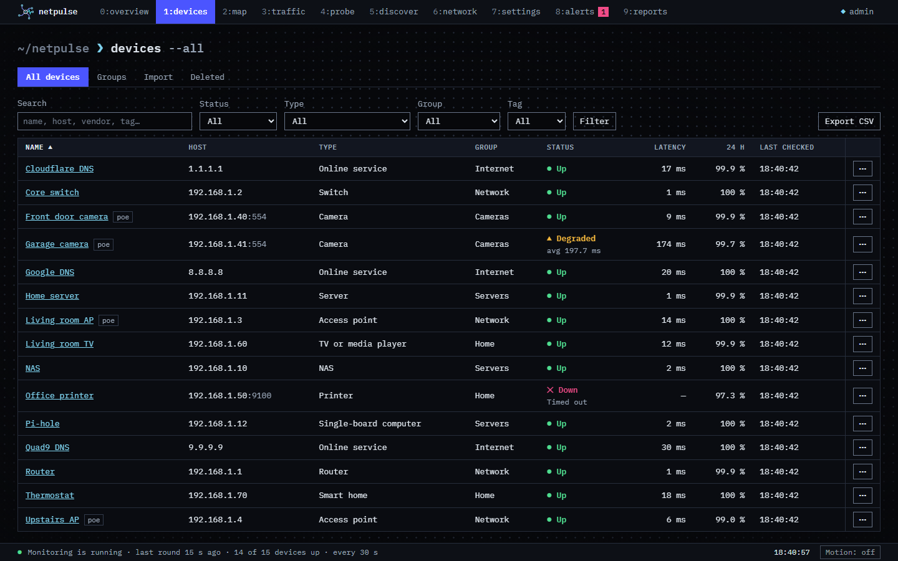
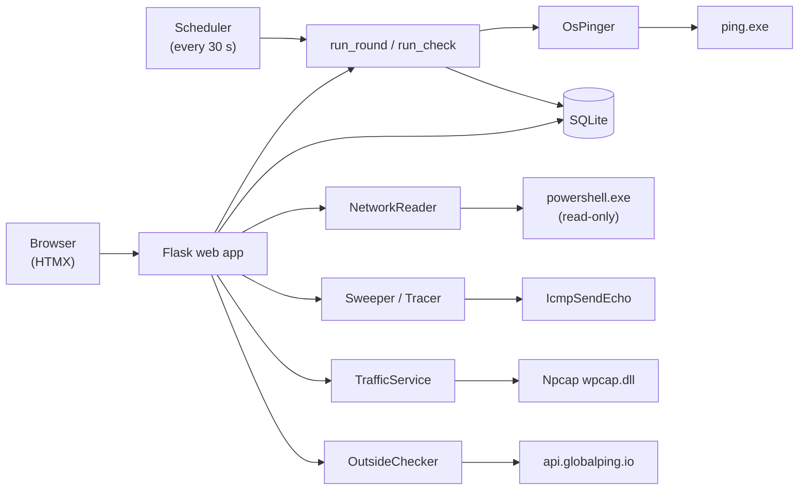

<div align="center">


**A self-hosted network monitor for a single Windows PC.**

NetPulse pings your devices on a schedule, keeps every result in SQLite, and shows status, history and outages in a browser dashboard built like a network operations screen.

[](LICENSE)
[](https://github.com/HighSkai/NetPulse/releases)
[](https://github.com/HighSkai/NetPulse/actions/workflows/ci.yml)


</div>



## Overview

NetPulse is a small Python web application that runs on your own Windows PC and watches the devices you care about: your router, a NAS, a printer, a public DNS server. Every 30 seconds it checks each device with Windows' own `ping.exe`, records the result, and turns that history into availability figures, latency charts and an outage log.

Beyond monitoring, it can show this PC's network settings, draw a map of how your devices are reached, sweep a local subnet for devices, trace the path to a host hop by hop, capture packets through Npcap, and ask probes around the world whether a server is reachable from outside your network.

It is designed for one machine. NetPulse listens on `127.0.0.1` only, needs no Administrator rights, and loads nothing from the internet: all scripts, styles and fonts ship inside the package.

## Features

- **Scheduled ICMP monitoring.** Every live device is checked once every 30 seconds. **Check now** runs one extra check on demand.
- **Clear device states.** Up, degraded, down or not checked. *Degraded* means the device answers but its last 10 checks were slow (average over 150 ms by default) or 2 or more failed. Both thresholds can be changed on the settings page.
- **Overview dashboard.** Summary cards, a problems list (longest outage first), donut charts by state, availability and latency, the slowest devices, recent outage events, and a 24-hour status grid.
- **Device history.** Per-device latency charts and availability bars over 1 hour, 6 hours, 24 hours, 7 days or 30 days, availability percentages, an outage log, and the latest checks.
- **Searchable device table.** Filter by status, search by name or host, and sort by any column.
- **Network page.** This PC's computer name, adapters, IPv4 addresses, gateways, DNS servers, DHCP lease and network category, read through Windows PowerShell, plus a router summary built from what Windows already reports.
- **Network map.** This PC, its subnets, gateways and every device, drawn with Cytoscape.js. Each line says whether Windows reported it, NetPulse inferred it, or you declared it.
- **Discovery sweeps.** Sweep one of this PC's private subnets (up to 256 addresses) with `IcmpSendEcho`. Results also include devices Windows found through ARP. Nothing is monitored until you accept it.
- **Path tracing.** Hop-by-hop traces with loss and best, average and worst times per hop, notes about rate-limited hops, and the likely slow link marked.
- **Packet capture (optional).** Live capture through Npcap with presets and filters, rates by direction and protocol, top talkers, and a PCAP file for every capture that opens in Wireshark.
- **Checks from outside (optional, opt-in).** Ping, TCP, traceroute or HTTP checks of a public host from Globalping's worldwide probes, only after you agree on the Outside tab.
- **Works without JavaScript.** Every action is a normal form post. With JavaScript, HTMX updates the page in place.
- **Light and dark themes.** Pages follow Windows' colour mode and respect its reduce-motion setting.

## Screenshots

The screenshots below are from a demo run with public test targets and NetPulse's built-in example network settings, not a real home network.

| Device page | Network map |
| --- | --- |
|  |  |



## Technology stack

| Layer | Technology |
| --- | --- |
| Language | Python 3.11+ |
| Web framework | [Flask](https://flask.palletsprojects.com/) 3.1+, Jinja templates |
| Storage | SQLite (Python standard library), write-ahead logging |
| Front end | [HTMX](https://htmx.org/) 2.0.4, [uPlot](https://github.com/leeoniya/uPlot) 1.6.32, [Cytoscape.js](https://js.cytoscape.org/) 3.34.3, all bundled |
| Windows integration | `ping.exe`, `IcmpSendEcho` via `ctypes`, Windows PowerShell (read-only), [Npcap](https://npcap.com/) `wpcap.dll` via `ctypes` |
| External service | [Globalping](https://globalping.io/) API, only after you agree |

Flask is the only third-party Python dependency.

## Architecture



The web UI is a client of a separate monitoring core. Operating-system access sits behind small interfaces (`Pinger`, `NetworkReader`, `PacketSource`), and `src/netpulse/__main__.py` is the one place that builds the real implementations and wires them together. Only `store.py` talks to SQLite, and only three modules touch the network: `netinfo/names.py` (reverse name lookups), `ping/icmp.py` (echoes) and `probes/globalping.py` (the only HTTP client).

## Requirements

- **Windows 10 or 11 with English as the display language.** Monitoring reads the output of `ping.exe` and understands English output only. On other display languages every check is recorded as `unreadable_output` rather than misread. Discovery sweeps and traces call Windows directly and work in any language.
- **Python 3.11 or newer.**
- **No Administrator rights.** NetPulse runs `ping.exe`, `IcmpSendEcho` and PowerShell as a normal user and does not use raw sockets.
- **Windows PowerShell** (included with Windows) for the network page and the map. Monitoring works without it.
- **Npcap (optional)** for packet capture. Everything else works without it.

On any other operating system NetPulse exits at startup with a one-line message.

## Installation

```powershell
git clone https://github.com/HighSkai/NetPulse.git
cd NetPulse
python -m venv .venv
.venv\Scripts\Activate.ps1
pip install .
```

This installs NetPulse and Flask into the virtual environment and adds a `netpulse` command. For development, `pip install -e ".[dev]"` installs an editable copy plus ruff, pytest and coverage.

### Optional: set up Npcap for packet capture

1. Download the installer from <https://npcap.com> and run it. This is the only step that needs an Administrator.
2. In the installer, leave **Restrict Npcap driver's access to Administrators only** unticked, so a normal user can capture.
3. Keep **Support loopback traffic** ticked if you want to capture traffic within this PC.
4. Start NetPulse. Its log says whether it found Npcap, and the traffic page explains why not if it did not.

NetPulse never installs Npcap itself, and loads `wpcap.dll` from `System32\Npcap` by its full path.

## Configuration

NetPulse has no configuration file and no environment variables. It is configured with command-line options and the settings page.

| Option | Default | Description |
| --- | --- | --- |
| `--db PATH` | `netpulse.db` in the current folder | SQLite file to use, created if missing. Start NetPulse from the same folder each time, or pass a full path. The full path is logged at startup. |
| `--port N` | `5000` | Port to listen on (always on `127.0.0.1`). |
| `--debug` | off | Flask debug mode: reloads on code changes and shows tracebacks. For development only. |

The **settings** page changes the two thresholds for *degraded* (average latency in ms, and failures out of the last 10 checks). Changes apply at once; stored history never changes with them. The page also shows how much space the database and captures take, and ends with a short manual.

### Where data is stored

- **Database:** one SQLite file (`netpulse.db` unless you pass `--db`). History is never pruned. At one check every 30 seconds it grows by about 317 KiB per device per day.
- **Packet captures:** PCAP files in a folder beside the database, named after it (`netpulse-captures` next to `netpulse.db`). NetPulse keeps the last 50 captures or every capture from the last 30 days, whichever keeps more.
- **Upgrades:** when a newer NetPulse opens an older database, it first copies it to a backup such as `netpulse.v1-backup-<timestamp>.db` next to the original, then upgrades it in place.

## Running NetPulse

```powershell
netpulse
```

or, equivalently:

```powershell
python -m netpulse --db C:\path\to\netpulse.db --port 5000
```

Then open <http://127.0.0.1:5000>. Checks start the moment NetPulse launches and run only while it is running. There is no Windows service, so stopping NetPulse leaves a gap in the history, which the charts show as *no data*. Press `Ctrl+C` to stop.

## Usage

1. **Add a device.** On the **devices** tab, enter a name and a host: a hostname such as `printer.lan` or a dotted IPv4 address such as `192.168.1.1`. Its first check runs within 30 seconds.
2. **Watch the overview.** The home page lists problems first, then breakdowns, then history, and refreshes itself every 30 seconds. The status bar at the bottom says whether monitoring itself is running, late or failing, so "monitoring stopped" never looks like "devices are down".
3. **Find devices.** On **discover**, pick one of this PC's private subnets and press **Sweep**. Review the results, then **Accept** the ones to monitor or **Ignore** the rest. Only sweep networks you own or manage.
4. **Trace a path.** On **probe**, enter a host and press **Trace**, or use **Trace** on a device's page.
5. **Capture traffic.** With Npcap installed, choose an interface and a preset or filter on **traffic**, then press **Start**. Download the PCAP from the capture's page to open it in Wireshark.
6. **Check from outside.** On the **Outside** tab of the probe page, read what is sent, agree, then check a public host from a continent, a country or the whole world.

Keyboard shortcuts: **Alt+0** to **Alt+7** open the overview, devices, map, traffic, probe, discover, network and settings tabs.

## Privacy and security

- **Local only.** NetPulse binds to `127.0.0.1` and has no login. It is not meant to be exposed to a network. Requests whose `Host` header is not `127.0.0.1` or `localhost` are refused, which blocks DNS-rebinding attacks, and every `POST` needs a CSRF token.
- **What leaves this PC:** ICMP echoes to targets you chose (your devices every 30 seconds, a sweep when you press **Sweep**, a trace when you press **Trace**), the name lookups Windows makes for them, and calls to Globalping's API, only after you agree on the Outside tab. Nothing else is fetched.
- **Globalping results are public.** Anyone with a check's id can see it. Addresses and names on your own network are refused before anything is sent.
- **Packet captures can hold sensitive data**, including other people's traffic and anything sent without encryption. Nothing is captured until you press **Start**, every page says when a capture is running, **Headers only** keeps just the first 128 bytes of each packet, and capture files never leave this PC. Only capture networks you own or manage.
- **Read-only system access.** The PowerShell script only reads network settings and changes nothing.

## Project structure

```text
src/netpulse/
├── __main__.py       entry point: builds the real adapters and starts the app
├── domain.py         devices, check results, status and outage rules
├── metrics.py        dashboard summary, search, filter and sort
├── network.py        this PC's network settings as values
├── topology.py       the map's tree, with each line's evidence
├── charts.py         donut charts, bar lists and the status grid, drawn on the server
├── checks.py         run_check and run_round
├── scheduler.py      background check loop and hourly maintenance
├── store.py          SQLite repository and schema upgrades
├── discovery.py      subnet sweeps
├── trace.py          path traces
├── traffic.py        packet capture service
├── outside.py        checks from outside through Globalping
├── ping/             ping.exe adapter, output parser, IcmpSendEcho, host validation
├── netinfo/          PowerShell network reader, parser, cache, name lookups
├── capture/          Npcap adapter, header decoder, PCAP reader and writer
├── probes/           Globalping client
└── web/              Flask app, routes, forms, templates/ and static/
```

## Troubleshooting

| Symptom | Cause and fix |
| --- | --- |
| Every check shows `unreadable_output` | Windows' display language is not English, so `ping.exe` output cannot be read. Switch the display language to English. |
| NetPulse exits at startup saying it runs on Windows only | NetPulse pings with Windows' `ping.exe`, so it runs on Windows only. |
| Startup fails with "Port 5000 is in use by another program" | Another program is using that port. Start with `--port 5001` or another free port. |
| My devices and history are gone | The default database is `netpulse.db` **in the current folder**. Start NetPulse from the folder you used before, or pass `--db` with a full path. The path in use is logged at startup. |
| The status bar says **Monitoring is late** | No round finished for over a minute, for example after the PC slept. It recovers on its own on the next round. |
| The network page or map says it cannot read the network settings | Windows PowerShell could not run. Monitoring carries on; the page says why. |
| The traffic page says capture is unavailable | Npcap is missing, or was installed with **Restrict Npcap driver's access to Administrators only**. Reinstall Npcap with that option unticked. |
| A host such as `192.168.1` or `010.0.0.1` is rejected | Shorthand addresses are refused on purpose, because Windows would ping a different address. Use the full dotted form. |

## Limitations

- Windows only, and English Windows only for monitoring.
- IPv4 addresses and hostnames only; no IPv6.
- One check interval, 30 seconds, for every device.
- No alerts or notifications, no login, and no access from other machines.
- No SNMP, router APIs or UPnP, and no decoding of packet contents beyond their headers.
- Deleted devices are hidden, not erased, and there is no undelete screen yet.
- Check history is never pruned.

## Reference

### Check results

A check is either a success with a round-trip time in whole milliseconds, or a failure with one of these codes:

| Code | Meaning |
| --- | --- |
| `timeout` | No reply within the wait time |
| `unreachable` | A router reported the destination unreachable |
| `name_resolution` | The hostname could not be resolved |
| `transmit_failed` | The local network stack could not send the request |
| `ttl_expired` | The packet expired in transit |
| `unreadable_output` | `ping.exe` output was empty, non-English, or unrecognized |

A reply faster than 1 ms (`time<1ms`) is stored as `0` ms. If `ping.exe` itself cannot run, nothing is stored: the round stops and the status bar shows the error.

<details>
<summary><strong>HTTP routes</strong></summary>

Every `POST` needs the page's CSRF token, as the `csrf_token` form field or an `X-CSRF-Token` header. Requests sent by HTMX (`HX-Request: true`) get HTML fragments where noted.

| Route | What it does |
| --- | --- |
| `GET /` | Overview: summary cards, problems, breakdown charts, slowest devices, recent events and the 24 h status grid |
| `GET /devices` | Device table and the add form. Takes `q`, `status`, `sort` and `dir` |
| `GET /devices/rows` | Device table body for the same parameters (polled every 30 s) |
| `POST /devices` | Add a device (`name`, `host`) |
| `GET /devices/<int:device_id>` | Device page. `range` is `1h`, `6h`, `24h` (default), `7d` or `30d` |
| `GET /devices/<int:device_id>/edit` | Edit form |
| `POST /devices/<int:device_id>/edit` | Save name, host and what the device connects through (`parent`) |
| `POST /devices/<int:device_id>/check` | Check now |
| `POST /devices/<int:device_id>/delete` | Hide the device and stop checking it; its history is kept |
| `GET /settings` | Settings page |
| `POST /settings` | Save the degraded thresholds (`latency_ms`, `failures`) |
| `GET /status` | Monitoring status bar (polled every 10 s) |
| `GET /network` | This PC's network settings and the router summary |
| `POST /network/refresh` | Read the network settings again |
| `GET /map` | Network map, drawn and as a list |
| `GET /map/view` | The map's list and drawing data (polled every 30 s) |
| `GET /discover` | Sweep form, last sweep and review list |
| `GET /discover/view` | Sweep progress and review list (polled while a sweep runs) |
| `POST /discover` | Start a sweep (`network`, and `confirm=yes` for a Public network) |
| `POST /discover/<int:host_id>/accept` | Monitor a discovered host |
| `POST /discover/<int:host_id>/ignore` | Ignore a discovered host |
| `POST /discover/<int:host_id>/restore` | Put an ignored host back on the review list |
| `GET /probe` | Path tab: trace form, newest trace and past traces |
| `GET /probe/view` | Trace in progress or just finished (polled while it runs) |
| `POST /probe/trace` | Trace the path to a host (`target`, `rounds`: 1, 5 or 10) |
| `GET /probe/traces/<int:trace_id>` | A past trace |
| `GET /probe/outside` | Outside tab: what is sent, the agreement, the check form and past checks |
| `GET /probe/outside/view` | Check in progress or just finished (polled while it runs) |
| `POST /probe/outside/consent` | Agree (`agree=yes`) or withdraw (`agree=no`) |
| `POST /probe/outside/check` | Check a public host from outside (`kind`, `target`, `port`, `path`, `scope`, `probes`) |
| `GET /probe/outside/checks/<int:check_id>` | A past check from outside |
| `GET /traffic` | Traffic page: start, watch and list captures |
| `GET /traffic/view` | Live part of the traffic page (polled while a capture runs) |
| `POST /traffic/start` | Start a capture (`interface`, `preset`, `filter`, `headers_only=yes`) |
| `POST /traffic/stop` | Stop the running capture |
| `GET /traffic/<int:capture_id>` | Capture page, 100 packets at a time (`page`) |
| `GET /traffic/<int:capture_id>/pcap` | Download the capture's PCAP file |
| `POST /traffic/<int:capture_id>/delete` | Delete a finished capture and its file (`confirm=yes`) |

</details>

## License

NetPulse is free software, licensed under the **GNU General Public License v3.0** (SPDX: `GPL-3.0-only`). See [LICENSE](LICENSE) for the full text.

Copyright (C) 2026 the NetPulse authors.

This program is distributed in the hope that it will be useful, but WITHOUT ANY WARRANTY; without even the implied warranty of MERCHANTABILITY or FITNESS FOR A PARTICULAR PURPOSE.

## Acknowledgments

NetPulse bundles or relies on these projects. Licence files for the bundled ones ship in `src/netpulse/web/static/`.

- [Flask](https://flask.palletsprojects.com/), the web framework.
- [HTMX](https://htmx.org/) for in-place page updates.
- [uPlot](https://github.com/leeoniya/uPlot) (MIT) for latency and traffic charts.
- [Cytoscape.js](https://js.cytoscape.org/) (MIT) for the network map.
- [IBM Plex Mono](https://github.com/IBM/plex) (SIL Open Font License 1.1), the interface typeface.
- [Npcap](https://npcap.com/) for packet capture, installed separately.
- [Globalping](https://globalping.io/) for checks from outside, a free public service.
